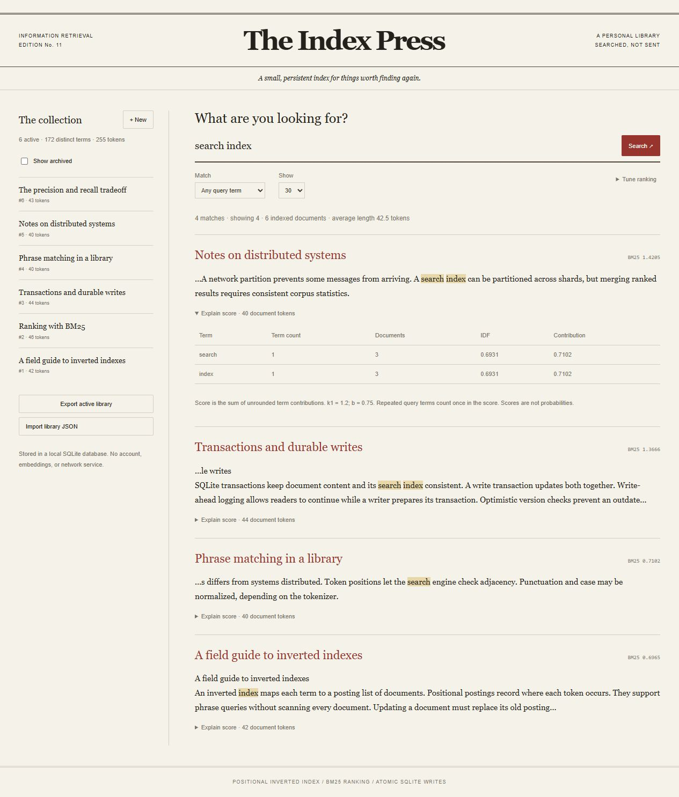

# Index Press

A persistent local document library with a positional inverted index, BM25 ranking, phrase queries, and transparent per-term score explanations. Its newspaper-style interface keeps the collection beside the search results.



## Run

Requires Python 3.10+ and a modern browser; there are no runtime package dependencies.

```sh
python run.py
```

Open http://127.0.0.1:8000/. The database defaults to `data/library.sqlite3`, which is excluded from Git. Use `--port 8830` or `--database path/to/library.sqlite3` to choose another port or database. Add your own notes or explicitly load the six sample documents through the interface. A fresh repository contains no personal documents or prepopulated database.

## Workflows

- Create and edit titled documents, paste text, or load a plain `.txt` file into the editor.
- Search any term, every term, or an exact token phrase. Inspect highlighted snippets and the term frequency, document frequency, IDF, and score contribution for each match.
- Adjust BM25 term saturation (`k1`) and document-length normalization (`b`). Settings changes invalidate old results.
- Archive documents without deleting them; restore them through **Show archived**. Archived content does not affect search or corpus statistics.
- Export active documents as library JSON and import that format atomically. Imports add new documents rather than overwriting existing IDs. An export is a content transfer, not a full backup of versions or archived state.
- Preserve unsaved edits until saved or explicitly discarded. Version checks reject stale writes, including when two browser tabs edit the same document.

The limits are 500 documents and 2,000,000 total characters, including archived documents. Each title is at most 120 characters and each body at most 40,000. Imports accept up to 500 documents and 8.5 MB of JSON; these must also fit the remaining library capacity.

## Retrieval model

Documents are normalized to Unicode NFKC when stored. The tokenizer extracts Unicode alphanumeric runs and case-folds them; punctuation and underscores separate tokens. There is no stemming, stop-word removal, language detection, or CJK word segmentation. Title and body tokens have equal weight. A position gap prevents phrase matches from crossing their boundary.

For each distinct query term, the contribution is:

```text
idf = ln(1 + (N - df + 0.5) / (df + 0.5))
score = idf × tf × (k1 + 1) / (tf + k1 × (1 - b + b × length / average_length))
```

The final score sums these contributions. Repeated query terms count once in ranking but retain their order and multiplicity in phrase matching. Defaults are `k1=1.2`, `b=0.75`. Equal scores use ascending document ID as a stable tie-breaker. Scores depend on the active corpus and are not probabilities or a guarantee that a document answers the query.

`search.py` owns SQLite storage, transactional updates, positional postings, ranking, and snippet segmentation. `run.py` serves a loopback-only JSON API with explicit static assets, request limits, browser-origin checks, and duplicate-key/nonfinite-number rejection. `app.js` renders snippets as text nodes and marks, never injected HTML.

Every write runs in a `BEGIN IMMEDIATE` transaction; read operations use a consistent snapshot. Content and postings update together. WAL mode supports concurrent readers, and optimistic document versions prevent lost edits. This is bounded single-machine retrieval, not a distributed search service or a replacement for a production search engine.

## API

| Endpoint | Purpose |
| --- | --- |
| `GET /api/library` | Metadata and active index statistics |
| `GET /api/document?id=1` | Full document with version and archive state |
| `GET /api/export` | Active document content |
| `GET /api/samples` | Sample collection without modifying storage |
| `POST /api/search` | `query`, `mode`, `k1`, `b`, `limit` |
| `POST /api/import` | `{ "documents": [{ "title": "Note", "text": "Words" }] }` |
| `POST /api/save` | `id`, current `version`, and `document` containing title/text |
| `POST /api/archive` | `id`, current `version`, and boolean `archived` |

Stale updates return HTTP 409. The database is not served over HTTP. This server is intended for local use and has no multi-user authentication.

## Verification

```sh
python -m unittest discover -s tests -v
npm run check
```

Node.js is needed only for the syntax check; no npm install is required. Thirteen Python tests cover hand-calculated BM25 scores, phrase adjacency and repeated tokens, Unicode normalization, index replacement, persistence, archive statistics, rollback after an injected mid-import failure, simultaneous conflicting writers, library limits, JSON validation, and HTTP access boundaries. CI runs Python 3.11 and 3.13 on Linux and Windows.

Browser verification covers sample indexing, search, document creation/editing, unsaved-edit protection, archive/restore search behavior, and persistence after reload.

## References

- [Robertson and Zaragoza: The Probabilistic Relevance Framework — BM25 and Beyond](https://doi.org/10.1561/1500000019)
- [SQLite foreign-key enforcement](https://sqlite.org/foreignkeys.html)

An independent information-retrieval project with genuine implementation history and reproducible checks.
